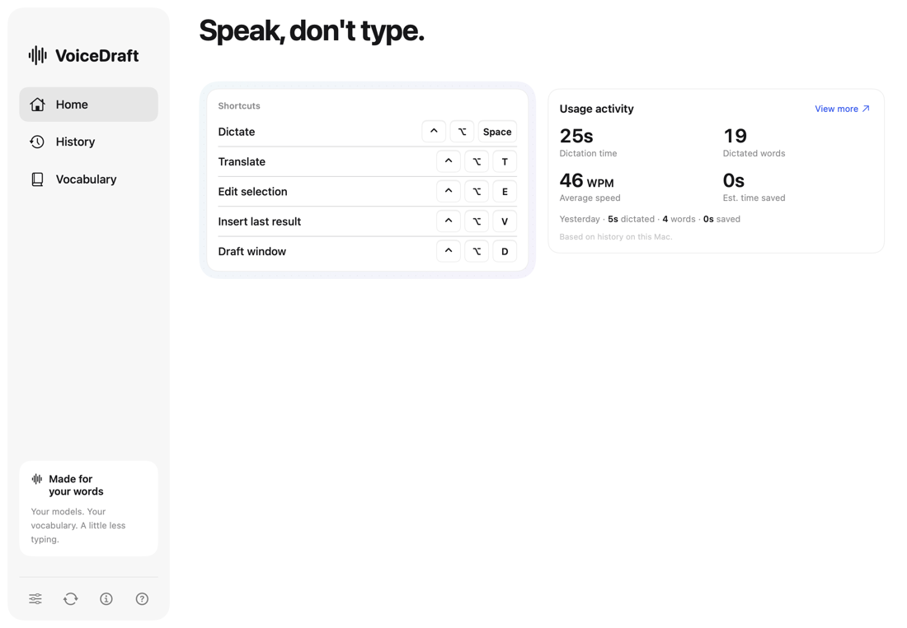

# VoiceDraft

Dictate into the Mac app you are using, translate as you speak, or select a paragraph and tell VoiceDraft how to edit it. You choose the speech and writing providers and use your own API keys.

- **Mac (macOS 13+)** · [Build from source](#build-the-mac-app) · [Track prebuilt downloads](https://github.com/ElmerZhang/voicedraft/releases) (first notarized package pending)
- **iPhone (iOS 17+)** · Build the app and keyboard extension in Xcode. See the [iPhone guide](ios/README.md).
- **Optional sync** · Share model settings and vocabulary between devices using the [self-hosted Go server](docs/server.md). You can dictate without setting up sync.



## Your first dictation on the Mac

1. Open **Settings → Models**. For the default Qwen setup, enter your Bailian key in both the speech and writing profiles and select the endpoints for your region. You can also use Doubao, a Whisper-compatible endpoint or Google Speech for recognition, and Chat Completions, Responses or Anthropic Messages for writing. See [provider setup](docs/selected-features.md#provider-setup).
2. Allow **Microphone** for recording and **Accessibility** for inserting the result into another app. Both permissions are in **System Settings → Privacy & Security**.
3. Click in a blank TextEdit document. Tap **Control + Option + Space**, speak a sentence, then tap again. VoiceDraft inserts the finished text at the cursor. You can change the shortcut in Settings.

### Where your data goes

Your device sends audio directly to your speech provider and text directly to your writing provider. History and any recordings you choose to keep stay on the device. If you enable sync, your server stores an encrypted copy of settings, vocabulary and provider keys. Optional on-screen context can send visible terms or excerpts to your providers when you turn it on. See the [privacy and security details](SECURITY.md).

## Build the Mac app

On a Mac with Xcode, the Swift toolchain and Python 3, run:

```sh
git clone https://github.com/ElmerZhang/voicedraft.git
cd voicedraft
./scripts/build-app.sh
open dist/VoiceDraft.app
```

The script produces a locally signed app for the architecture of the build machine. Move the app to Applications if you want to keep using it.

## Shortcuts

| Shortcut | Behavior |
| --- | --- |
| Control + Option + Space | Start polished dictation / finish recording |
| Control + Option + T | Translate into your configured language |
| Control + Option + E | Speak an editing instruction for selected editable text |
| Control + Option + A | Ask a question, optionally using selected text; show result in the app |

Shortcuts are configurable in Settings. Fn works alone or combined with Shift, Control, Option or Command (hold the modifier, then press Fn); set macOS's Fn (🌐) key action to Do Nothing first.

Recordings are limited to ten minutes per take; the take finishes automatically at the limit, and HTTP speech models receive longer audio in chunks under the provider's five-minute limit. `qwen-audio-3.1-asr-flash-message` streams audio while you speak and shows a live transcript above the compact recording controls. You can say a correction (for example, “把刚才的周二改成周四”) before finishing; Polish and Translate pass the complete transcript to the writing model with explicit self-correction instructions. Verbatim keeps the recognized words, including correction instructions. HTTP speech models still recognize after you finish recording. Choose **Input device** in Settings: follow the system default or select a microphone. The recording capsule has Cancel, an input-level waveform, and Finish; hover for the actual microphone and elapsed time. Nothing is inserted until you finish. If insertion is disabled or the current focus is clearly unsuitable, a persistent result card lets you copy the text. Device selection is local and does not change macOS Sound settings.

The floating recording panel does not take keyboard focus. Ordinary dictation goes to the field focused when the result is ready. Selection-based editing checks that the original selection is still available. VoiceDraft pastes unless the focus is clearly not an input: buttons, menus, static text, disabled controls, password fields and apps without a focused window get a copy card instead. When an app does not expose a text field (some chat, terminal and custom-drawn apps), the paste is still sent and the result card stays up with "Paste sent · copy here if nothing appeared" so you can copy it if nothing arrived. Accessibility support varies between applications; password fields are blocked. No automatic Enter/send keystroke is generated.

## Pages

- **Home**: enabled shortcuts as single-line key-cap rows on the left (stacked above the summary only in very narrow layouts) and a usage summary on the right: four large totals across all retained local history (dictation time, dictated words, average WPM, estimated time saved) and one line for yesterday (hidden when there are no records for yesterday). **View more** opens **Settings → Usage**, which adds Personalization (current vocabulary coverage), the 365-day activity calendar and daily details. Deleted/expired history is excluded, and disabling history pauses new activity.
- **History**: records grouped by day, search, dictation/question filters, original transcript details, copy, deletion, and the local-history toggle.
- **Vocabulary**: searchable word grid, enabled/disabled filters, add/edit, bulk add, and per-word controls in the context menu. Changes save immediately. Model projection details remain available below the grid.
- **Settings** (sidebar or **Command-comma**): an overlay with shortcuts, recording, on-screen context, audio, language, general and update preferences, plus Personalization, Models, Usage, Sync, About, and Help tabs. Models and Sync are settings tabs, not pages. Save writing style and translation target in Personalization.

The interface follows the system light or dark appearance; the recording HUD is always dark. The shared visual language is defined in [docs/design.md](docs/design.md).

## Start configuration sync locally

```sh
./scripts/run-server.sh
```

The service listens on `http://127.0.0.1:8765`. Its randomly generated access token is saved at `.local/access-token`; copy it into the app's **Sync** page. Choose a separate, strong sync passphrase of at least 12 characters. Do not use your Bailian API key as the sync access token or passphrase.

- First Mac: save the connection, then **Sync now**.
- New device: use the same server URL, access token, and sync passphrase; save the connection, then **Download server copy**. For an iPhone, open **Pair another device** on the Mac's Sync tab and scan the code with the iPhone camera instead of typing.
- Enable automatic sync to synchronize after saves and every 30 seconds while Studio or History is open. Editing model/vocabulary pages pauses background polling to protect unsaved form edits.
- Conflicting changes stop with an explicit message. Downloading a server copy requires confirmation and replaces local model settings and vocabulary. Reapply any local edits you want to keep afterward.

Localhost is only reachable from the same machine. For multiple physical devices, deploy the service on a shared HTTPS host using [the server guide](docs/server.md). Both the Mac and iPhone clients can use the same vault.

## Included

- Multiple saved provider profiles; speech and writing are selected independently.
- Model catalog, protocol-specific endpoints, separate API keys, read-only vocabulary adaptation previews, and advanced JSON parameters.
- Dictation cleanup, spoken self-corrections, structured formatting, translation, selected-text editing, and text-only question answering through your configured writing provider.
- One app-wide vocabulary with enabled terms, strength, priority, language, aliases, preferred spelling, and IPA pronunciation. Adapters derive context or weighted hotwords and show omitted/downgraded data while retaining the full source. Manage it in **Vocabulary**, not individual profiles. Writing also receives spelling and alias guidance. Recognition is not guaranteed to use every supplied term.
- Encrypted sync of profiles, API keys, active selections, vocabulary, writing preferences, and translation target.
- Eight interface languages (简体中文、繁體中文, English, 日本語, 한국어, Deutsch, Français, Español), selected in **Settings → Language** or following the system. This choice is local and separate from the translation target.
- The Draft window (Control-Option-D, File › Draft window or the menu bar) is for long-form writing by voice, one paragraph per take: with the window focused, press the dictation shortcut, speak a paragraph and release; the polished paragraph lands at the cursor as its own paragraph (or inline, or over the selection), with the text around the cursor as reference so it reads on. Select text and press the Edit shortcut to change it by voice; with nothing selected the instruction applies to the whole draft. Command-Z undoes a take in one step; Re-polish last take rewrites it with another style. Copy all, Insert into previous app and Export (.md or .txt) take the draft elsewhere. Drafts are saved locally under `~/Library/Application Support/VoiceDraft/drafts/` and are not synced; see [architecture](docs/architecture.md#draft-window-since-2026-11-10).
- Insert last result again (Control-Option-V or the menu bar item) pastes the most recent result into the input focused now, for takes that landed in the wrong app. It reuses clipboard-preserving insertion and writes no new History entry.
- Opt-in on-screen context (off by default): when dictating into another app, names and terms visible in its front window become low-priority recognition hints, and a short excerpt near the cursor helps Polish and Translate match names and tone. Text comes from Accessibility, with optional window-only on-device OCR (Screen Recording). **Extract words from this screen…** in the menu bar adds reviewed terms to Vocabulary. Visible text is sent to your configured speech and writing providers only while the feature is on; it stays in memory, is never saved, written to history or synced, and password managers plus any apps you exclude are never read.
- A menu bar entry, recording HUD with the bound input device, cancellation, clipboard preservation, searchable local history, and history deletion/opt-out.
- A local usage log of token counts per model call; no text. It is a monthly JSONL file under `~/Library/Application Support/VoiceDraft/Usage/`, never synced or shown; see [architecture](docs/architecture.md#model-usage-log).
- A Go sync server with SQLite persistence and a standalone binary; model calls go directly from Mac to the configured endpoint. No external Swift packages.

## Verification

```sh
./scripts/test-all.sh
```

Requires Go 1.25+, the Swift toolchain, and Python 3 for the localization checks only. This runs Go vet/build/race tests, then starts an isolated Go localhost service and tests encryption, two-device synchronization, stale revisions, concurrent updates, authentication, malformed input, request construction, response parsing, redirect rejection, streaming writing, and a simulated Qwen audio-to-writing pipeline. It does not access a microphone or a real model account. Server tests can run without network sockets using `cd server && go test -race ./...`; full Swift integration requires loopback listening permission.

To inspect the interface without credentials, microphone or provider calls, run the packaged binary with `VOICEDRAFT_CAPTURE_PREVIEWS=<dir>` (pages and settings tabs), `VOICEDRAFT_CAPTURE_ONBOARDING=<dir>`, `VOICEDRAFT_CAPTURE_HUD_PREVIEWS=<dir>` or `VOICEDRAFT_CAPTURE_SHEETS=<dir>` (every sheet and the Clear history confirmation); add `VOICEDRAFT_PREVIEW_APPEARANCE=dark` for dark mode, or the arguments `-interfaceLanguage zh-Hans` (any supported code) for another interface language. Each mode writes PNGs and exits. Keep the capture process frontmost: when another app is active, native controls are captured in their inactive gray state.

See [architecture](docs/architecture.md), [iOS client](docs/ios.md), [deployment](docs/server.md), [roadmap](docs/roadmap.md), and [validation](docs/validation.md).

Settings now use schema v3. v1/v2 profiles and vocabulary migrate in memory while keeping profile IDs and keys; the next save persists v3. Global lines and all profile terms are merged, with active-profile overrides winning conflicts. Remote vocabulary IDs are preserved as recovery references until their contents are imported. Upgrade other syncing clients before sharing the new settings.

## Adding a language

Add its case and matching rules in `AppLanguage`/`L10n`, provide complete `Localizable.strings`, `Desktop.strings`, and `InfoPlist.strings` catalogs, and include the locale in the packaging and localization checks. UI labels and app errors use `L` / `LocalizedMessage`; never localize protocol values or saved user content. Run the catalog checker, Swift tests, and inspect the packaged UI before shipping.

## Official API references

- [Qwen vocabulary formats and limits](https://help.aliyun.com/zh/model-studio/improve-asr-accuracy)
- [Qwen Audio HTTP API](https://help.aliyun.com/zh/model-studio/fun-asr-flash-recorded-speech-recognition-http-api)
- [Qwen ASR Message WebSocket API](https://help.aliyun.com/zh/model-studio/qwen-asr-message-websocket-api)
- [Qwen ASR Message client events](https://help.aliyun.com/zh/model-studio/qwen-asr-message-client-events)
- [Qwen ASR Message server events](https://help.aliyun.com/zh/model-studio/qwen-asr-message-server-events)
- [Qwen ASR HTTP API](https://www.alibabacloud.com/help/en/model-studio/qwen-asr-api-reference)
- [Bailian OpenAI-compatible text generation](https://www.alibabacloud.com/help/en/model-studio/compatibility-of-openai-with-dashscope)
- Public behaviour that inspired this project: [Typeless quickstart](https://www.typeless.com/help/quickstart) and [Ask anything](https://www.typeless.com/ask-anything). Independent implementation, no code copied.

## Selected feature expansion (0.2)

VoiceDraft now includes hold/tap recording shortcuts, configurable keys, 10-minute capture, recording sounds/mute, Doubao/Whisper-compatible/Google speech, three writing protocols with streaming/model discovery, reusable per-app writing styles, local context, vocabulary files, automatic Codex/Claude context and project-name discovery with writing-model filtering, usage counts, retained audio and history retry/expiry, login launch and onboarding with optional domain vocabulary packs.

See [the selected feature checklist and provider setup](docs/selected-features.md) and [self-hosted signed update publishing](docs/updates.md). The new controls have English and Chinese copy; other interface languages currently fall back to English for these additions. This is a local implementation, not a deployed update service or a claim of real-account provider acceptance.

## License

VoiceDraft is licensed under the [GNU Affero General Public License v3.0](LICENSE) (AGPL-3.0-only). Contributions require agreeing to the [Contributor License Agreement](CLA.md).

## Security

See [SECURITY.md](SECURITY.md) for how to report a vulnerability and for the threat model.

## Trademark

The name "VoiceDraft" and its icon are covered by a separate policy: see [TRADEMARK.md](TRADEMARK.md).

## Contributing

See [CONTRIBUTING.md](CONTRIBUTING.md) for build, test and contribution rules.
